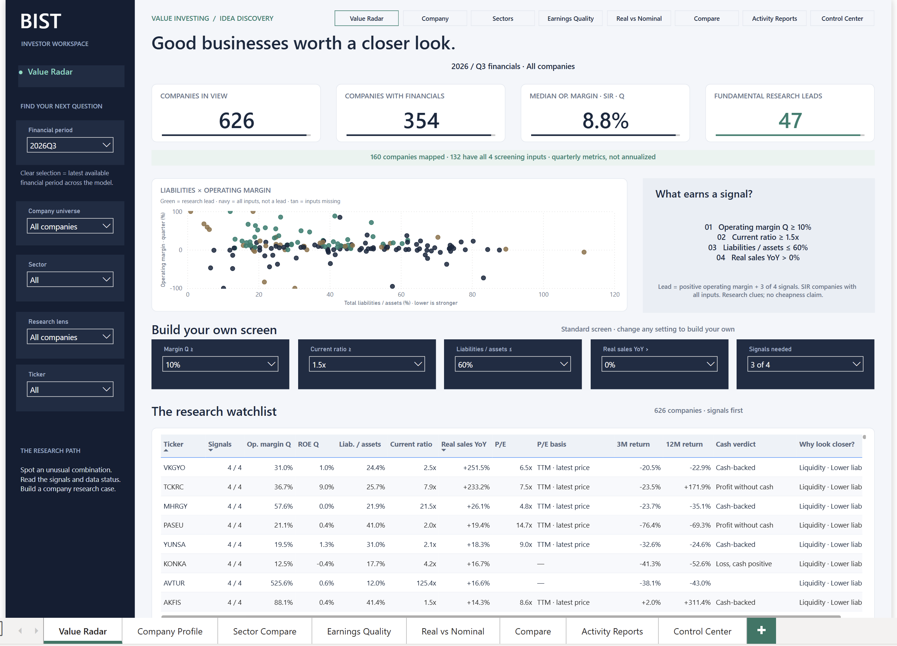
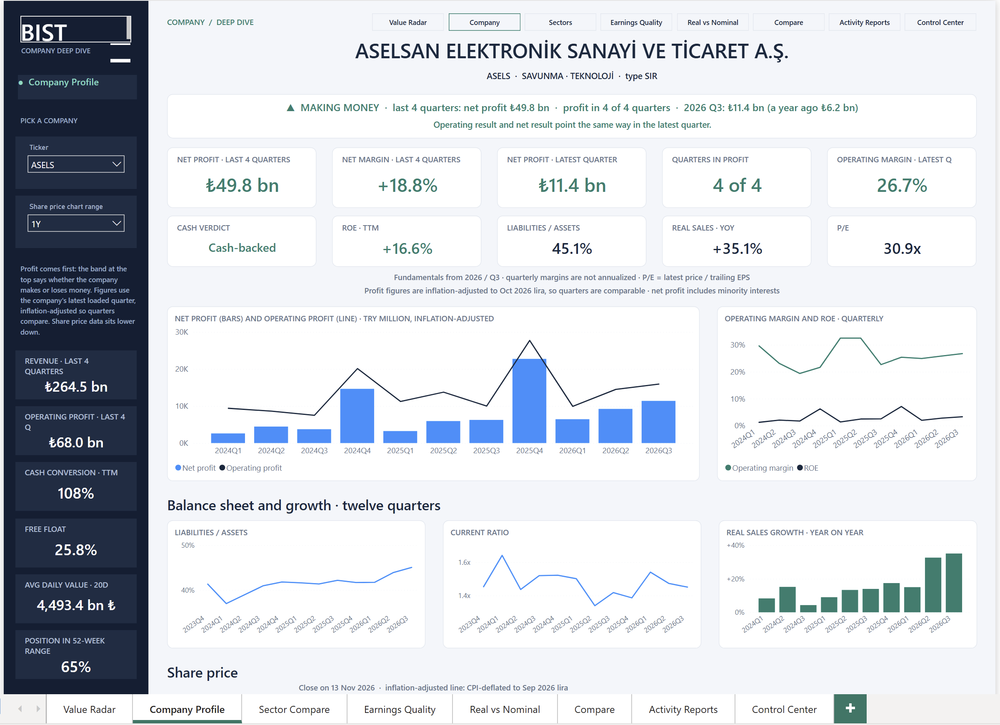
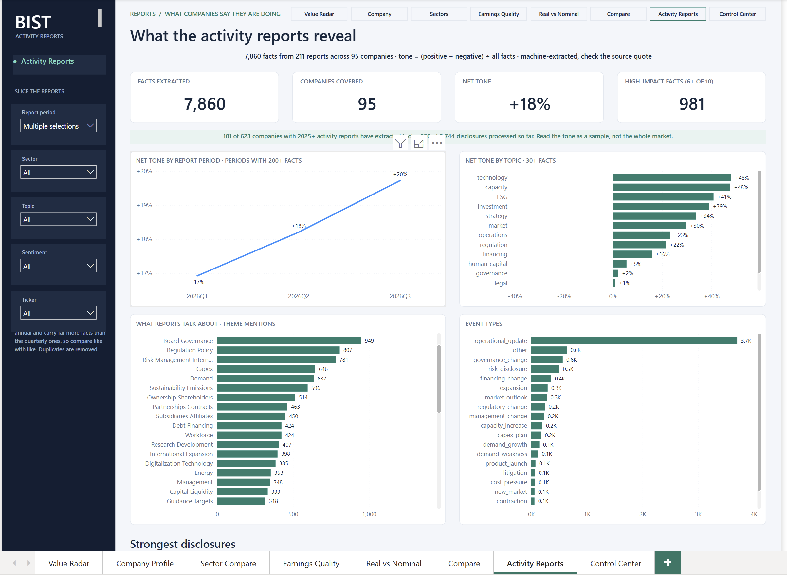
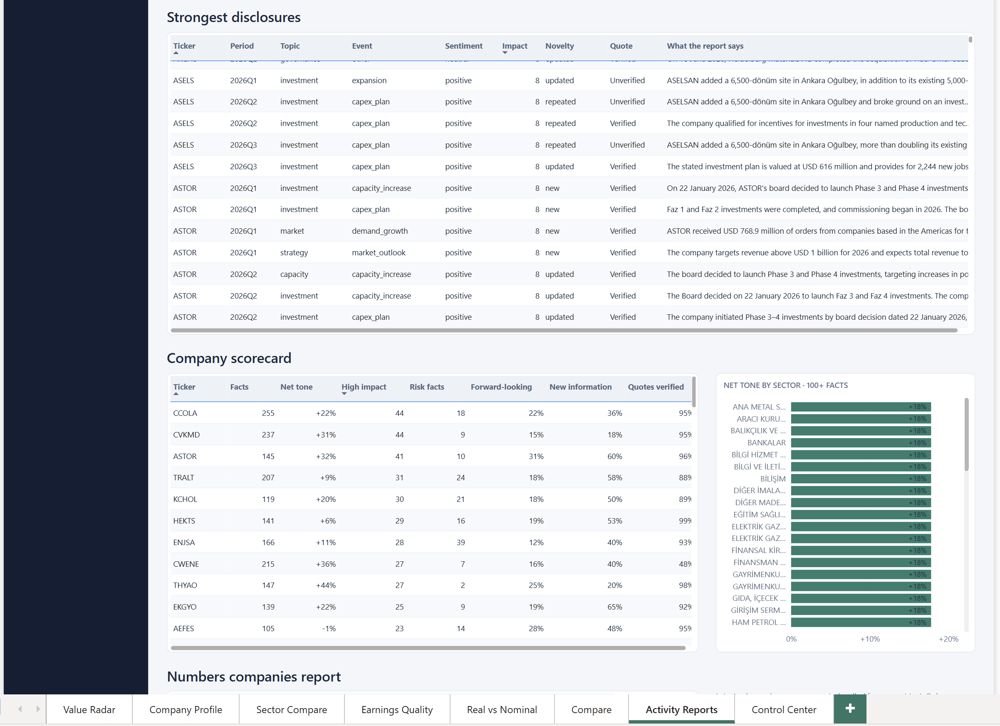

# BIST Intelligence

🇹🇷 **[Türkçe açıklama için tıklayın](#turkce)**

I built this project to analyze Borsa İstanbul companies using their actual filings. All of
the data is public on KAP, but it is spread across thousands of spreadsheets and PDF reports,
and with Turkey's high inflation, nominal figures are hard to compare over time. This project
collects the financial statements and activity reports of BIST companies, cleans them, adjusts
them for inflation, and stores everything in one PostgreSQL database. You can use it to track a
company over many years, compare companies within a sector, screen for businesses with strong
margins and low debt, or review what management says in their reports without reading every
PDF.

The database is especially useful with AI agents. Because the data is already clean and in one
place, an agent can answer a question like "Which industrial companies grew real sales for four
quarters in a row and have liabilities below 50% of assets?" with a few SQL queries, then check
the activity report facts to see how each company explains its results. The Gold `current_*`
views (financial values, ratios, EPS, P/E, prices, and activity report facts) are the best
place to start. The results are not investment advice. Use them to find ideas faster, and
always confirm them against the original filings.



<table>
  <tr>
    <td width="33%"><a href="docs/dashboard_screenshots/company_profile.png"></a></td>
    <td width="33%"><a href="docs/dashboard_screenshots/activity_reports_1.png"></a></td>
    <td width="33%"><a href="docs/dashboard_screenshots/activity_reports_2.png"></a></td>
  </tr>
  <tr>
    <td align="center"><b>Company Profile</b></td>
    <td align="center"><b>Activity Reports</b></td>
    <td align="center"><b>Disclosures and scorecard</b></td>
  </tr>
</table>

**[Download the Power BI dashboard](https://github.com/kaan-turgut/bist-intelligence/releases/latest)**
(`BIST Dashboard.pbix`, data included). Open it in Power BI Desktop to explore every page
without setting up the database. Click a screenshot to see it at full size.

Data pipelines for companies listed on Borsa İstanbul (BIST). Both pipelines read from KAP
(Public Disclosure Platform) and write to one shared PostgreSQL database, `bist_finance`.

| Pipeline | What it does | Guide |
| --- | --- | --- |
| **Financial statements** | Downloads KAP financial statement archives, parses statements and EPS disclosures, adds CPI/USD reference data and İş Yatırım prices, and publishes Bronze/Silver/Gold financial values, ratios, EPS and P/E. | [docs/financial_statements.md](docs/financial_statements.md) (Türkçe / English) |
| **Activity reports** | Indexes and downloads KAP activity report PDFs, extracts and chunks their text, and uses an LLM to extract facts about operations, strategy, investment, risks, governance and outlook. | [docs/activity_reports.md](docs/activity_reports.md) |

Both pipelines share issuer identity (MKK OID, ticker aliases, sectors, indexes) from the
`metadata` schema, which is maintained by `bist.companies`.

> [!WARNING]
> **This project does not predict share prices or give investment advice.** The data may contain
> errors, and nothing here is a recommendation to buy or sell any security. Check important
> results against the original KAP filings. See the full [Disclaimer](#disclaimer).

## Setup

You need Python 3.11+ and PostgreSQL 15+.

```bash
python3 -m venv .venv
source .venv/bin/activate
python -m pip install -r requirements-dev.txt   # runtime only: requirements.txt
export BIST_FINANCE_DSN="dbname=bist_finance host=localhost user=YOUR_USER"
export OPENAI_API_KEY="YOUR_API_KEY"            # activity report extraction only
```

On Windows, create the environment with `py -3.11 -m venv .venv`, activate it with
`.\.venv\Scripts\Activate.ps1`, and set variables with `$env:BIST_FINANCE_DSN = "..."`.
[.env.example](.env.example) lists every variable; `.env` files are not loaded automatically.

The connection uses `BIST_FINANCE_DSN`, then `DATABASE_URL`, then the local default
`dbname=bist_finance`. Any other database name is rejected.

Run every command from the repository root.

### Create the database

```bash
python -m bist.financials init-postgres --create-database   # metadata, Bronze/Silver/Gold/Ops, seed companies
python -m bist.activity_reports.processor migrate-db         # activity report tables
```

All SQL migrations live in [database/migrations/](database/migrations/). Numbered files
(`001_…`–`017_…`) belong to the metadata and financial schemas; `activity_reports_*.sql`
files extend the same database and are tracked in `ops.schema_migrations`.

## Common commands

```bash
# Shared company metadata
python -m bist.companies.update_company_info --symbols THYAO

# Financial statements: download, parse and publish
python -m bist.financials run --symbols THYAO --begin-year 2017 --begin-quarter 1 --end-year 2026 --end-quarter 2
python -m bist.financials update-prices --symbols THYAO --begin-date 2017-01-01 --end-date 2026-06-30
python -m bist.financials calculate-pe --symbols THYAO

# Inflation adjustment: one project-wide CPI target month for every value
python -m bist.financials show-price-level
python -m bist.financials set-price-level 2026-10   # recalculates everything, then switches

# Activity reports: index, download, ingest and extract
python -m bist.activity_reports.fetcher index-and-download --symbols THYAO --begin-date 2017-01-01 --end-date "$(date +%F)"
python -m bist.activity_reports.processor ingest --symbols THYAO
python -m bist.activity_reports.processor extract --symbols THYAO
```

Add `--help` to any command for its options. The guides in [docs/](docs/) describe every
command, the published tables and views, and the data-quality safeguards.

## Project layout

```text
bist/
  paths.py, logging_config.py, http_utils.py   Shared paths, logging and HTTP retry helpers
  companies/          Shared issuer metadata: Company model, bist_finance connection,
                      KAP metadata refresh, alias resolution, JSON seed import
  financials/         Financial statement pipeline (CLI: python -m bist.financials)
    cli.py            Command-line entry point
    models/           EPS, capital, P/E and financial value calculations
    parsing/          Locating KAP archives, parsing statements and EPS disclosures
    services/         Downloads, PostgreSQL publication, prices, repairs
  activity_reports/   Activity report pipeline
    fetcher.py        KAP disclosure index and PDF downloads (CLI)
    processor.py      Text ingestion, LLM extraction, embeddings (CLI)
    catalog.py, store.py, fact_analysis.py
database/migrations/  SQL migrations for the shared bist_finance database
data_mappings/        KAP statement mappings and seed company metadata
docs/                 Pipeline guides and the activity report database guide (PDF)
notebooks/            Financial statement validation notebook
reports/              Published analysis reports (PDF)
database_backups/     Table exports taken before production repairs (not in Git)
tests/
  financials/         Financial pipeline tests
  activity_reports/   Activity report pipeline tests
financial_statements/ Downloaded KAP archives: <SYMBOL>/<SYMBOL>_<YEAR>.zip (not in Git)
activity_reports/     Downloaded activity report PDFs: <SYMBOL>/<SYMBOL>_<YEAR>_<PERIOD>_<INDEX>.pdf (not in Git)
```

## Development

```bash
python -m pytest
ruff check .
```

PostgreSQL integration tests are skipped unless their test database is configured. No test
calls paid APIs, and neither suite touches the database in `BIST_FINANCE_DSN`.

- **Financial tests** (`tests/financials/`): set `BIST_TEST_POSTGRES_DSN` to a server
  connection whose role has `CREATEDB`. The fixtures create and drop a throwaway database
  for each test module.
- **Activity report tests** (`tests/activity_reports/`): set `BIST_TEST_DSN` to a
  **separate, disposable** database named `bist_finance` that already has the shared schema.
  The tests delete activity report rows there and refuse to run against the configured
  application database.

<a id="disclaimer"></a>

## Disclaimer

**Not investment advice.** The information, comments and analysis in this project, including
the code, the database, the Power BI dashboard and the reports, are not investment advice. In
Turkey, investment advice is provided only by licensed institutions under an investment advisory
agreement. The content here is general information and may not suit your financial situation or
risk preferences. Do not make investment decisions based only on this information.

**Screening results are not recommendations.** Labels such as "research lead", "signal" or
"watchlist" are research starting points created by fixed rules. They are not a recommendation
or an opinion on whether any security is cheap, expensive, or worth buying, holding or selling.

**No guarantee of accuracy.** The data is collected and processed automatically. Financial
statements are parsed by code, values are adjusted for inflation with estimates, and activity
report facts are extracted by an LLM. The data may contain errors, omissions or delays, and
the sources themselves may correct their filings later. Always check important information
against the original KAP filings.

**No liability.** This project is provided "as is", without warranty of any kind. The author
is not responsible for any direct or indirect loss resulting from the use of the code, the
data or the dashboard. You use them at your own risk.

**No affiliation.** This project is independent. It is not affiliated with, endorsed by or
sponsored by Borsa İstanbul, KAP (Kamuyu Aydınlatma Platformu), MKK (Merkezi Kayıt Kuruluşu),
İş Yatırım, the Capital Markets Board of Turkey (SPK) or any listed company. Their names are
used only to describe the data sources.

**Third-party data.** Company filings come from KAP, and share prices come from İş Yatırım.
This data belongs to its original sources and remains subject to their terms of use. If you
run the pipelines yourself, you are responsible for following those terms, including request
limits.

## License

The code is released under the [MIT License](LICENSE). The license covers the software in this
repository, not the third-party data it collects.

<a id="turkce"></a>

## Türkçe

Bu projeyi Borsa İstanbul şirketlerini kendi resmi bildirimleri üzerinden analiz edebilmek için
geliştirdim. Verilerin tamamı KAP'ta herkese açık, ancak binlerce tabloya ve PDF rapora dağılmış
durumda. Türkiye'deki yüksek enflasyon nedeniyle de nominal rakamları yıllar arasında
karşılaştırmak zor. Bu proje BIST şirketlerinin finansal tablolarını ve faaliyet raporlarını
topluyor, temizliyor, enflasyona göre düzeltiyor ve hepsini tek bir PostgreSQL veritabanında
saklıyor. Bir şirketi uzun yıllar boyunca takip etmek, aynı sektördeki şirketleri karşılaştırmak,
yüksek kâr marjlı ve düşük borçlu şirketleri taramak ya da her PDF'i tek tek okumadan yönetimin
raporlarda ne söylediğini incelemek için kullanabilirsiniz.

Veritabanı özellikle AI agent'larla birlikte kullanıldığında faydalı. Veriler zaten temiz ve
tek bir yerde olduğu için bir AI agent, "Son dört çeyrekte reel satışlarını art arda
artıran ve yükümlülükleri varlıklarının %50'sinin altında olan sanayi şirketleri hangileri?"
gibi bir soruyu birkaç SQL sorgusuyla yanıtlayabilir, ardından faaliyet raporu bulgularına
bakarak her şirketin sonuçlarını nasıl açıkladığını kontrol edebilir. Başlamak için en iyi yer
Gold katmanındaki `current_*` view'larıdır (finansal değerler, oranlar, EPS, F/K, fiyatlar ve
faaliyet raporu bulguları). Sonuçlar yatırım tavsiyesi değildir. Fikir bulmayı
hızlandırmak için kullanın ve her zaman orijinal bildirimlerle doğrulayın.

**[Power BI dashboard'unu indirin](https://github.com/kaan-turgut/bist-intelligence/releases/latest)**
(`BIST Dashboard.pbix`, veriler dahil). Veritabanı kurmadan tüm sayfaları incelemek için Power BI
Desktop ile açabilirsiniz. Dashboard'un ekran görüntüleri sayfanın başında yer alıyor; tam boyutta
görmek için bir görüntüye tıklayın.

Bu depo, Borsa İstanbul'da (BIST) işlem gören şirketler için veri pipeline'ları içerir. İki
pipeline da KAP'tan (Kamuyu Aydınlatma Platformu) veri okur ve ortak bir PostgreSQL veritabanına,
`bist_finance`'a yazar.

| Pipeline | Ne yapar | Kılavuz |
| --- | --- | --- |
| **Finansal tablolar** | KAP finansal tablo arşivlerini indirir, tabloları ve EPS açıklamalarını parse eder, TÜFE/USD referans verilerini ve İş Yatırım fiyatlarını ekler; Bronze/Silver/Gold katmanlarında finansal değerleri, oranları, EPS'yi ve F/K'yı yayımlar. | [docs/financial_statements.md](docs/financial_statements.md) (Türkçe / English) |
| **Faaliyet raporları** | KAP faaliyet raporu PDF'lerini index'ler ve indirir, metinlerini çıkarıp chunk'lara böler ve bir LLM ile faaliyetler, strateji, yatırım, riskler, yönetişim ve beklentiler hakkında bulgular çıkarır. | [docs/activity_reports.md](docs/activity_reports.md) (İngilizce) |

İki pipeline da şirket kimlik bilgilerini (MKK OID, ticker alias'ları, sektörler, endeksler)
`bist.companies` tarafından yönetilen `metadata` şemasından paylaşır.

> [!WARNING]
> **Bu proje hisse fiyatı tahmini yapmaz ve yatırım tavsiyesi vermez.** Veriler hata
> içerebilir ve buradaki hiçbir bilgi bir menkul kıymeti alma ya da satma önerisi değildir.
> Önemli sonuçları orijinal KAP bildirimleriyle karşılaştırın. Ayrıntılar için
> [Yasal Uyarı](#yasal-uyari) bölümüne bakın.

### Kurulum

Python 3.11+ ve PostgreSQL 15+ gereklidir.

```bash
python3 -m venv .venv
source .venv/bin/activate
python -m pip install -r requirements-dev.txt   # yalnızca çalıştırmak için: requirements.txt
export BIST_FINANCE_DSN="dbname=bist_finance host=localhost user=KULLANICI_ADINIZ"
export OPENAI_API_KEY="API_ANAHTARINIZ"         # yalnızca faaliyet raporu extraction için
```

Windows'ta ortamı `py -3.11 -m venv .venv` ile oluşturun, `.\.venv\Scripts\Activate.ps1` ile
etkinleştirin ve değişkenleri `$env:BIST_FINANCE_DSN = "..."` biçiminde tanımlayın.
[.env.example](.env.example) tüm değişkenleri listeler; `.env` dosyaları otomatik olarak
yüklenmez.

Bağlantı sırasıyla `BIST_FINANCE_DSN`, `DATABASE_URL` ve yerel varsayılan `dbname=bist_finance`
değerlerini kullanır. Başka bir veritabanı adı kabul edilmez.

Tüm komutları deponun kök dizininden çalıştırın.

#### Veritabanını oluşturma

```bash
python -m bist.financials init-postgres --create-database   # metadata, Bronze/Silver/Gold/Ops, seed şirketler
python -m bist.activity_reports.processor migrate-db         # faaliyet raporu tabloları
```

Tüm SQL migration dosyaları [database/migrations/](database/migrations/) klasöründedir.
Numaralı dosyalar (`001_…`–`017_…`) metadata ve finansal şemalara aittir;
`activity_reports_*.sql` dosyaları aynı veritabanını genişletir ve `ops.schema_migrations`
tablosunda izlenir.

### Sık kullanılan komutlar

```bash
# Ortak şirket metadata'sı
python -m bist.companies.update_company_info --symbols THYAO

# Finansal tablolar: download, parse ve publish
python -m bist.financials run --symbols THYAO --begin-year 2017 --begin-quarter 1 --end-year 2026 --end-quarter 2
python -m bist.financials update-prices --symbols THYAO --begin-date 2017-01-01 --end-date 2026-06-30
python -m bist.financials calculate-pe --symbols THYAO

# Enflasyon düzeltmesi: tüm değerler için proje genelinde tek bir TÜFE hedef ayı
python -m bist.financials show-price-level
python -m bist.financials set-price-level 2026-10   # her şeyi yeniden hesaplar, sonra geçiş yapar

# Faaliyet raporları: index, download, ingest ve extract
python -m bist.activity_reports.fetcher index-and-download --symbols THYAO --begin-date 2017-01-01 --end-date "$(date +%F)"
python -m bist.activity_reports.processor ingest --symbols THYAO
python -m bist.activity_reports.processor extract --symbols THYAO
```

Seçenekleri görmek için herhangi bir komuta `--help` ekleyin. [docs/](docs/) klasöründeki
kılavuzlar tüm komutları, yayımlanan tabloları ve view'ları ve veri kalitesi önlemlerini
açıklar.

### Proje yapısı

```text
bist/
  paths.py, logging_config.py, http_utils.py   Ortak path'ler, logging ve HTTP retry helper'ları
  companies/          Ortak şirket metadata'sı: Company modeli, bist_finance bağlantısı,
                      KAP metadata güncellemesi, alias çözümleme, JSON seed import
  financials/         Finansal tablo pipeline'ı (CLI: python -m bist.financials)
    cli.py            CLI entry point
    models/           EPS, sermaye, F/K ve finansal değer hesaplamaları
    parsing/          KAP arşivlerini bulma, tabloları ve EPS açıklamalarını parse etme
    services/         Download'lar, PostgreSQL'e publish, fiyatlar, repair'ler
  activity_reports/   Faaliyet raporu pipeline'ı
    fetcher.py        KAP bildirim index'i ve PDF download'ları (CLI)
    processor.py      Metin ingest, LLM extraction, embedding'ler (CLI)
    catalog.py, store.py, fact_analysis.py
database/migrations/  Ortak bist_finance veritabanı için SQL migration dosyaları
data_mappings/        KAP tablo mapping'leri ve seed şirket metadata'sı
docs/                 Pipeline kılavuzları ve faaliyet raporu veritabanı kılavuzu (PDF)
notebooks/            Finansal tablo doğrulama notebook'u
reports/              Yayımlanmış analiz raporları (PDF)
database_backups/     Production repair'lerinden önce alınan tablo yedekleri (Git'te değil)
tests/
  financials/         Finansal pipeline testleri
  activity_reports/   Faaliyet raporu pipeline testleri
financial_statements/ İndirilen KAP arşivleri: <SYMBOL>/<SYMBOL>_<YEAR>.zip (Git'te değil)
activity_reports/     İndirilen faaliyet raporu PDF'leri: <SYMBOL>/<SYMBOL>_<YEAR>_<PERIOD>_<INDEX>.pdf (Git'te değil)
```

### Geliştirme

```bash
python -m pytest
ruff check .
```

PostgreSQL integration testleri, test veritabanları ayarlanmadıkça atlanır. Hiçbir test ücretli
API çağırmaz ve iki test grubu da `BIST_FINANCE_DSN` içindeki veritabanına dokunmaz.

- **Finansal testler** (`tests/financials/`): `BIST_TEST_POSTGRES_DSN` değişkenini, rolü
  `CREATEDB` yetkisine sahip bir sunucu bağlantısına ayarlayın. Fixture'lar her test modülü için
  geçici bir veritabanı oluşturur ve sonra siler.
- **Faaliyet raporu testleri** (`tests/activity_reports/`): `BIST_TEST_DSN` değişkenini, ortak
  şemaya zaten sahip olan, `bist_finance` adlı **ayrı ve silinebilir** bir veritabanına ayarlayın.
  Testler oradaki faaliyet raporu satırlarını siler ve yapılandırılmış uygulama veritabanında
  çalışmayı reddeder.

<a id="yasal-uyari"></a>

### Yasal Uyarı

**Yatırım tavsiyesi değildir.** Bu projede (kod, veritabanı, Power BI dashboard'u ve raporlar)
yer alan yatırım bilgi, yorum ve tavsiyeleri yatırım danışmanlığı kapsamında değildir. Yatırım
danışmanlığı hizmeti; aracı kurumlar, portföy yönetim şirketleri, mevduat kabul etmeyen bankalar
ile müşteri arasında imzalanacak yatırım danışmanlığı sözleşmesi çerçevesinde sunulmaktadır.
Burada yer alan yorum ve tavsiyeler, yorum ve tavsiyede bulunanların kişisel görüşlerine
dayanmaktadır. Bu görüşler mali durumunuz ile risk ve getiri tercihlerinize uygun olmayabilir.
Bu nedenle, sadece burada yer alan bilgilere dayanılarak yatırım kararı verilmesi
beklentilerinize uygun sonuçlar doğurmayabilir.

**Tarama sonuçları öneri değildir.** "Research lead", "sinyal" veya "watchlist" gibi etiketler,
sabit kurallarla oluşturulan araştırma başlangıç noktalarıdır. Herhangi bir menkul kıymetin ucuz
ya da pahalı olduğuna veya alınması, tutulması ya da satılması gerektiğine dair bir öneri veya
görüş değildir.

**Doğruluk garantisi yoktur.** Veriler otomatik olarak toplanır ve işlenir. Finansal tablolar
kodla parse edilir, değerler tahminlere dayanarak enflasyona göre düzeltilir ve faaliyet raporu
bulguları bir LLM tarafından çıkarılır. Veriler hata, eksiklik veya gecikme içerebilir; kaynaklar
da bildirimlerini sonradan düzeltebilir. Önemli bilgileri her zaman orijinal KAP bildirimleriyle
kontrol edin.

**Sorumluluk kabul edilmez.** Bu proje "olduğu gibi" ve hiçbir garanti verilmeden sunulur. Proje
sahibi, kodun, verilerin veya dashboard'un kullanımından doğabilecek doğrudan ya da dolaylı
hiçbir zarardan sorumlu değildir. Kullanım riski tamamen kullanıcıya aittir.

**Herhangi bir kurumla bağlantı yoktur.** Bu proje bağımsızdır. Borsa İstanbul, KAP (Kamuyu
Aydınlatma Platformu), MKK (Merkezi Kayıt Kuruluşu), İş Yatırım, Sermaye Piyasası Kurulu (SPK)
veya herhangi bir borsa şirketiyle bağlantılı değildir; bu kurumlar tarafından onaylanmamış veya
desteklenmemektedir. Kurum adları yalnızca veri kaynaklarını belirtmek için kullanılır.

**Üçüncü taraf verileri.** Şirket bildirimleri KAP'tan, hisse fiyatları İş Yatırım'dan alınır.
Bu veriler asıl sahiplerine aittir ve onların kullanım koşullarına tabidir. Pipeline'ları kendiniz
çalıştırırsanız, istek sınırları dahil bu koşullara uymak sizin sorumluluğunuzdadır.

### Lisans

Kod [MIT Lisansı](LICENSE) ile yayımlanmıştır. Lisans bu depodaki yazılımı kapsar, yazılımın
topladığı üçüncü taraf verilerini kapsamaz.

[↑ Başa dön](#bist-intelligence)
